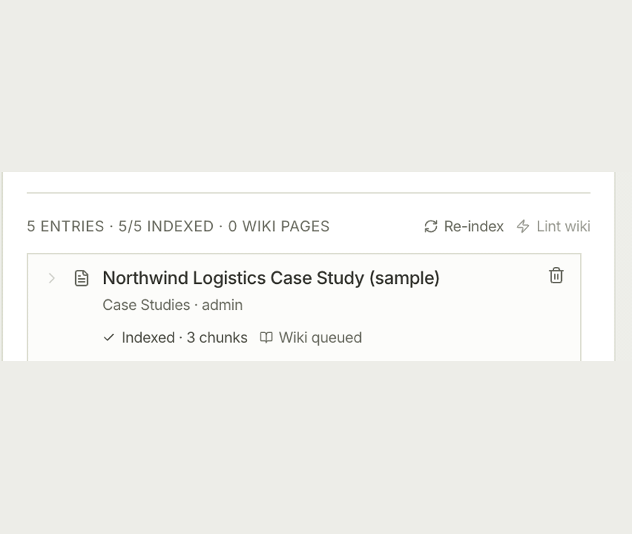

# ClientLens

Sales reps lose the agenda, fumble objections and forget follow-ups on calls, so ClientLens is an open-source Chrome sidebar that drafts pitches from your own knowledge base and coaches you live in Google Meet, on your own LLM keys.

**Demo site:** https://avinashgaurav.github.io/clientlens/



> [!NOTE]
> **Evals: the fact check that guards every pitch**
>
> | Measure | Result |
> |---|---|
> | Planted false claims caught by the fact check | **13 / 13** |
> | Planted claims that could still be written to a doc | **0 / 13** |
> | Fully supported decks wrongly flagged | **0 / 6** |
>
> Smoke test, not a benchmark: 18 fictional decks and one knowledge base, run through the Claude Code CLI rather than the production API path; 9 of the 12 planted decks were held for review rather than cleanly redacted. Method and every hold: [EVALS.md](EVALS.md).

## Why AI here, why code there

| Step | Done by | Why |
|---|---|---|
| Drafting pitches, emails, objection replies and live coaching cues | LLM, on your keys | Writing from your own material is what models are good at. |
| Checking numeric and named claims against the cited sources | LLM validator | Deciding whether a sentence is supported needs reading, so it is a judgement, not a proof. |
| Removing a flagged claim, or holding the draft for review | Code, fails closed | A claim is cut only when it can be located without ambiguity; anything unreadable or ambiguous holds the draft. |
| Writing a draft into Google Slides or Docs | Code: the service worker's write gate | Only a "verified" or "redacted" draft, and only from the extension's own pages. Unit tested. |
| Looking for a restatement after a cut | Code, a heuristic | Shared figures, names and keywords; it can miss paraphrases (see [Known limitations](docs/limitations-and-roadmap.md#known-limitations)). |

## Quick start

> [!IMPORTANT]
> **Authentication is not wired in v1.0.** The sidebar provisions a local admin and the backend runs with `DEV_MODE=true`, so **keep the backend off the public internet**. That is fine for the single-user, self-hosted case v1.0 targets, and not safe for a shared team deployment. Full posture: [Security model](docs/security.md).

Prerequisites: Node 20+, Python 3.11+ (`brew install python@3.11`), a Supabase project (free tier is fine), and one LLM provider key.

```bash
git clone https://github.com/avinashgaurav/clientlens.git
cd clientlens

bash scripts/setup_env.sh          # writes backend/.env and extension/.env

cd backend && python3.11 -m venv venv && source venv/bin/activate
pip install -r requirements.txt
uvicorn main:app --reload --port 8000     # health check: curl localhost:8000/health

cd ../extension && npm install && npm run dev
```

`npm run dev` is a watch build (`vite build --watch`), so it does not exit. Leave it
running and open a second terminal for anything else.

Then load `extension/dist/` at `chrome://extensions` with Developer mode on, and click the extension icon. **There is no sign-in step**: the panel opens straight into an admin session.

## More

- [Features in detail](docs/features.md): what it does, the loop in screens, every surface
- [Limitations and roadmap](docs/limitations-and-roadmap.md): what v1.0 is not, known limitations, what comes next
- [Configuration](docs/configuration.md): both `.env` files, Gemini models on a new key, the manifest template
- [Architecture](docs/architecture.md): how the pieces fit, project layout, tech stack
- [Development guide](docs/development.md): mock mode, build modes, running the CI checks locally
- [Security model](docs/security.md): auth posture and what to lock down before deploying
- [Evals](EVALS.md) · [Contributing](CONTRIBUTING.md)

## License

[MIT](LICENSE) © 2026 Avinash Gaurav.

Free to use, modify and distribute. Bring-your-own-keys means you run it on your own provider accounts: there is no ClientLens-hosted service and no telemetry.
