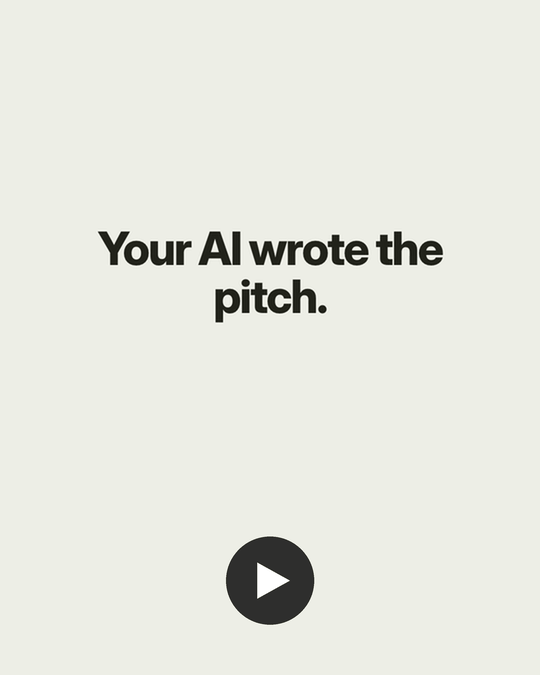
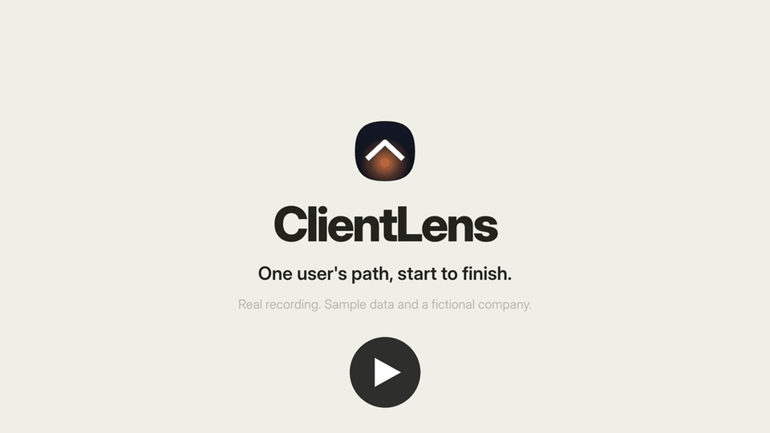
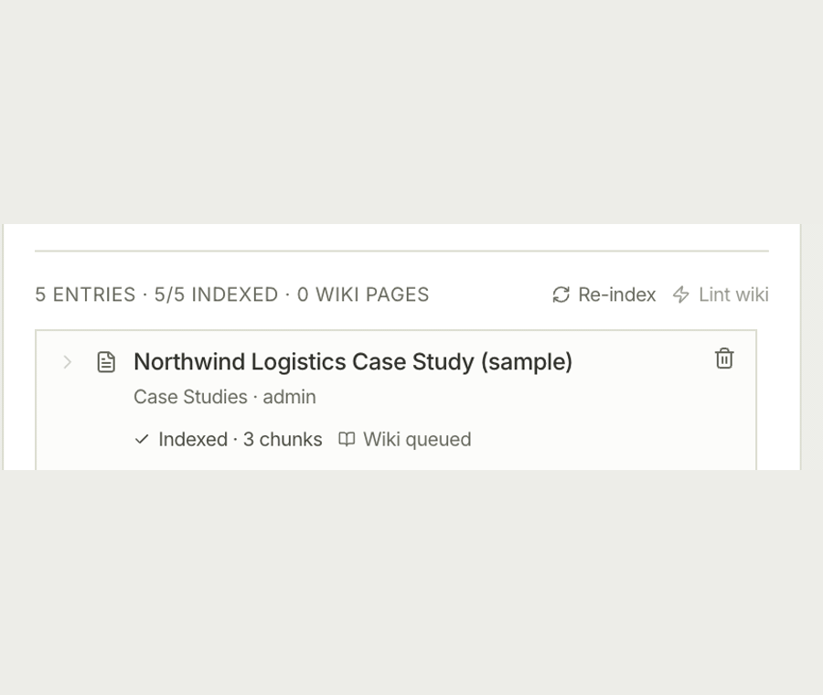

# ClientLens

Sales reps lose the agenda, fumble objections and forget follow-ups on calls, so ClientLens is an open-source Chrome sidebar that drafts pitches from your own knowledge base and coaches you live in Google Meet. Use the hosted backend, or self-host it on your own LLM keys.

**Demo site:** https://clientlens-ai.vercel.app/

## Watch

<a href="https://github.com/avinashgaurav/clientlens/releases/download/v1.1.0/ClientLens-brag.mp4"></a>
<a href="https://github.com/avinashgaurav/clientlens/releases/download/v1.1.0/ClientLens-user-journey.mp4"></a>

- [Launch video](https://github.com/avinashgaurav/clientlens/releases/download/v1.1.0/ClientLens-brag.mp4) (43 s): Start with your own docs and case studies, say who you are pitching, and four agents build the draft: retrieve context, brand compliance, ICP personalization, fact check. A claim that cannot be backed up is held, not shipped. It closes on the first eval (13/13 planted false claims caught, 0/13 could still be written to a doc, 0/6 supported decks wrongly flagged) and the pitch, email and objection formats.
- [User journey](https://github.com/avinashgaurav/clientlens/releases/download/v1.1.0/ClientLens-user-journey.mp4) (72 s): Eight steps on sample data and a fictional company: sign in with email and password, load sample data from Quick settings, the knowledge base, fill in the pitch, the four agents run, the result with two claims held for review, the weekly insights, and sign out. It ends with the two things that need your own setup.

## Try it

1. Download `ClientLens-extension.zip` from the [latest release](https://github.com/avinashgaurav/clientlens/releases/latest) and unzip it.
2. Open `chrome://extensions`, turn on **Developer mode**, click **Load unpacked** and pick the unzipped folder.
3. Click the ClientLens icon to open the side panel, click **Create an account** and sign up with your email and a password of at least 8 characters.
4. Open **Quick settings** and turn on **Try ClientLens with sample data**, then open the **Generate** tab and draft a pitch.

## Good to know

- Each account is its own private workspace with a daily AI allowance.
- There's no email step to sign up. Password reset isn't available yet, so keep your password somewhere safe.
- The AI runs on a free-tier key with a small daily quota, so it can say it is busy or used up for today. Try again later if you see that.
- **Needs setup:** export to Google Slides and Docs (needs a Google OAuth client ID) and live coaching in Google Meet (needs a Deepgram key).



> [!NOTE]
> **Tests: the fact check that guards every pitch**
>
> | What was tested | Result |
> |---|---|
> | False claims I planted that the fact check caught | **13 / 13** |
> | Planted claims that could still be written to a doc | **0 / 13** |
> | Fully supported decks wrongly flagged | **0 / 6** |
> | Ask-KB answers right with keyword search, after fixing 9 bugs (same questions, so a best case) | **57 / 69** (was 36 / 69) |
> | Ask-KB answers right with real Gemini search (same questions, best case; embedding called directly, backend bypassed) | **66 / 69** |
>
> This is a quick first check, not a full benchmark. It used 18 made-up decks and one knowledge base. I ran it through the Claude Code CLI, not the way the live app calls the AI. 9 of the 12 decks with planted claims were held for a person to review, instead of having the claim cleanly cut. How it was run, and why each deck was held: [EVALS.md](EVALS.md). The search test, its 9 bugs and the rerun after the fixes: [EVALS-RAG.md](EVALS-RAG.md).

## Why AI here, why code there

| Step | Done by | Why |
|---|---|---|
| Drafting pitches, emails, objection replies and live coaching cues | LLM, on your keys | Writing from your own material is what models are good at. |
| Checking numbers and names against the cited sources | An AI checker | Deciding whether a sentence is backed up means reading it, so this is a judgement call, not a proof. |
| Removing a flagged claim, or holding the draft for review | Code, fails closed | A claim is cut only when it can be located without ambiguity; anything unreadable or ambiguous holds the draft. |
| Writing a draft into Google Slides or Docs | Code: the service worker's write gate | Only a "verified" or "redacted" draft, and only from the extension's own pages. Covered by automated tests. |
| Looking for a restatement after a cut | Code, a heuristic | Shared figures, names and keywords; it can miss paraphrases (see [Known limitations](docs/limitations-and-roadmap.md#known-limitations)). |

## Quick start

Run your own: host ClientLens on your own backend and keys instead of using the hosted one. Setup details: [Configuration](docs/configuration.md).

> [!IMPORTANT]
> **Sign-in is email and password, with open sign-up.** Every account is its own workspace, and each user has daily usage caps. Full posture: [Security model](docs/security.md). Deploying the backend to Vercel with Supabase: [Configuration](docs/configuration.md).

Prerequisites: Node 20+, Python 3.11+ (`brew install python@3.11`), a Supabase project (free tier is fine), and one LLM provider key.

```bash
git clone https://github.com/avinashgaurav/clientlens.git
cd clientlens

bash scripts/setup_env.sh          # writes backend/.env and extension/.env

cd backend && python3.11 -m venv venv && source venv/bin/activate
pip install -r requirements.txt
uvicorn main:app --reload --port 8000     # health check: curl localhost:8000/health

cd ../extension && npm install && npm run dev
```

`npm run dev` is a watch build (`vite build --watch`), so it does not exit. Leave it
running and open a second terminal for anything else.

Then load `extension/dist/` at `chrome://extensions` with Developer mode on, and click the extension icon. With `VITE_DEV_MODE=true` (local development) the panel skips sign-in; a real build opens on the sign-in screen.

## More

- **Sister project:** [Followthrough](https://github.com/avinashgaurav/followthrough) picks up after the call. It finds every client ask in a transcript, with the client's exact words, and tracks it from shipped to client told.
- [Features in detail](docs/features.md): what it does, the loop in screens, every surface
- [Limitations and roadmap](docs/limitations-and-roadmap.md): what v1.0 is not, known limitations, what comes next
- [Configuration](docs/configuration.md): both `.env` files, Gemini models on a new key, the manifest template
- [Architecture](docs/architecture.md): how the pieces fit, project layout, tech stack
- [Development guide](docs/development.md): mock mode, build modes, running the CI checks locally
- [Security model](docs/security.md): auth posture and what to lock down before deploying
- [Evals](EVALS.md) · [Search-and-answer test](EVALS-RAG.md) · [Contributing](CONTRIBUTING.md)

## License

[MIT](LICENSE) © 2026 Avinash Gaurav.

Free to use, modify and distribute. You can use the hosted backend, or self-host it and run it on your own provider accounts. The extension sends no telemetry. The landing page (clientlens-ai.vercel.app) counts anonymous page views with Vercel Analytics.
