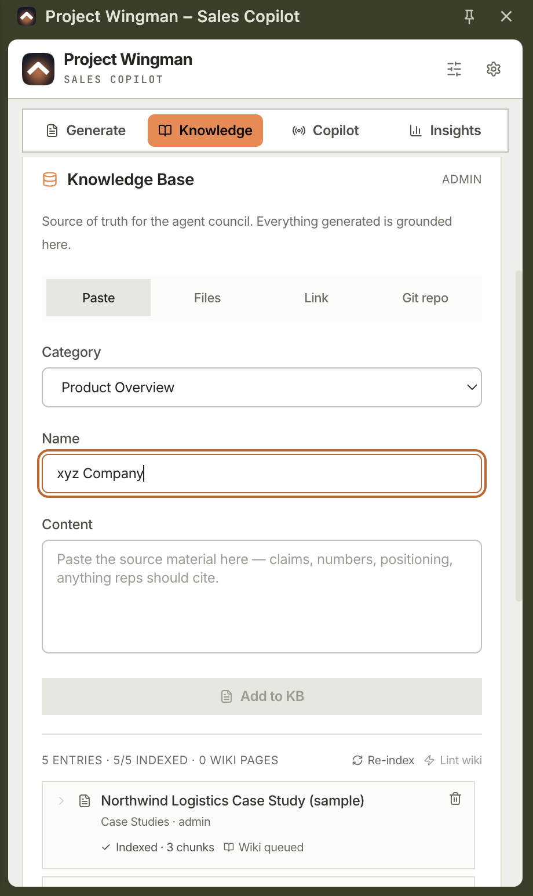
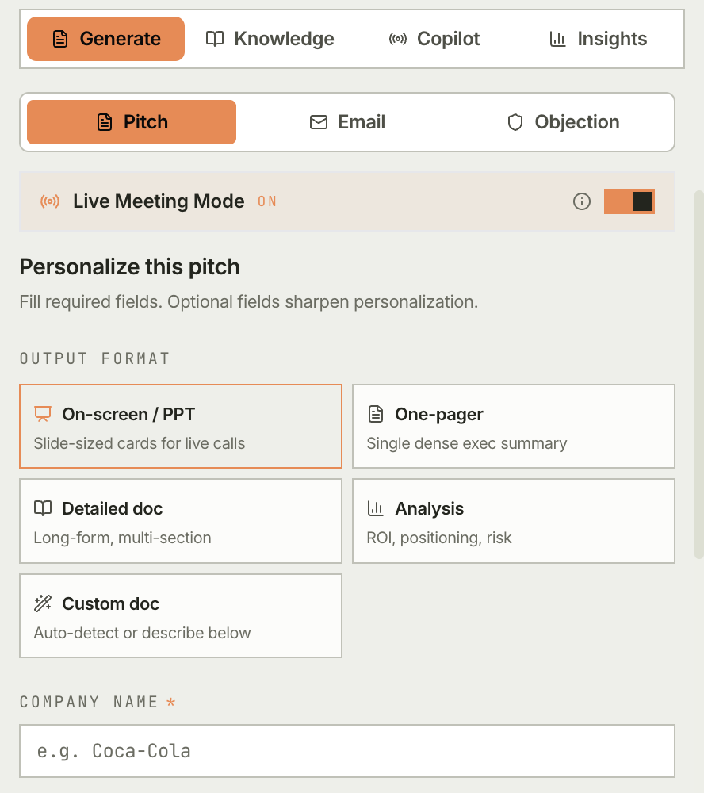
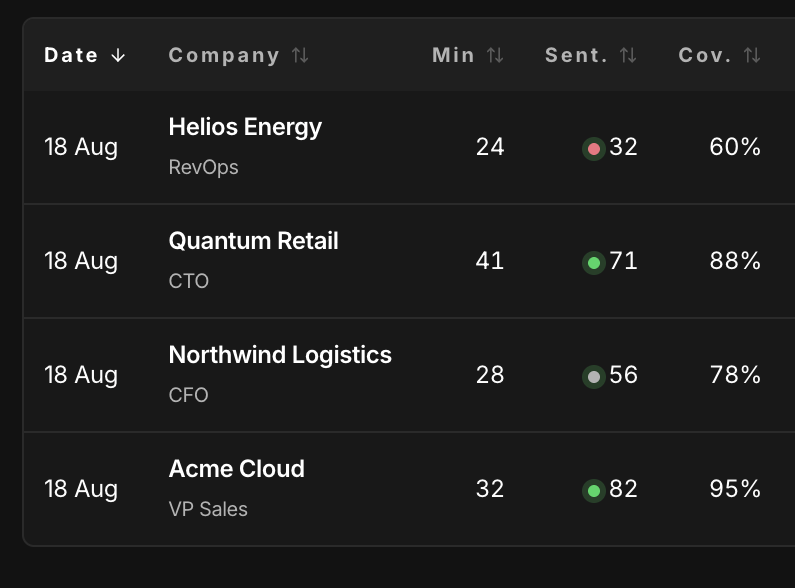
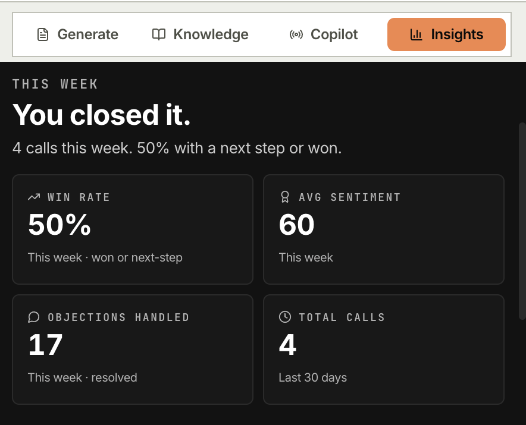

# Features in detail

Every surface, in full. For the short version see the [README](../README.md).

## What it does

**The open-source AI sales copilot that lives in your browser sidebar.**

Live coaching during Google Meet calls, pitch generation grounded in your own knowledge base, and objection handling on tap. Runs on your LLM keys, on your infrastructure. There is no ClientLens server.

A sales rep's typical hour: jump into Google Meet, lose track of the agenda, fumble the objection, take a half-page of notes, paste them into the CRM, then forget the follow-up. ClientLens compresses that loop.

- **Pre-call.** Generate a personalized pitch and a tailored email from the prospect's public signals and your indexed knowledge base.
- **During the call.** Four agents run on the live transcript: sentiment, agenda pacing, a coach that surfaces the next-best sentence and objection handles, and a validator that checks each coach suggestion against your knowledge base: it shows an approved suggestion, swaps in its rewrite of one it revises, and drops one it rejects or cannot read. A small overlay mirrors the cues on the Meet tab itself.
- **After the call.** A structured summary with agenda coverage, sentiment timeline, objections and action items. One click pushes it to Zoho CRM.

Outputs are grounded in your knowledge base: agents are prompted to cite a source for each numeric claim, and a validation pass checks those claims. It is an LLM check, not a guarantee; see [Known limitations](limitations-and-roadmap.md#known-limitations).

### The loop, in screens

| | |
|---|---|
| **Load your material.** Case studies and battle cards, indexed and chunked. Every citation resolves back to one of these. |  |
| **Draft the pitch.** Five output formats and a buyer persona. Live meeting mode on for the call itself. |  |
| **Take the calls.** Each one lands with its sentiment and how much of the agenda you covered. |  |

Insights after a week of calls. Every screenshot here is the real extension, with sample data loaded.

## Features in detail

### 1. Personalized Pitch Generation

A multi-agent pipeline that turns "company name + ICP" into a structured pitch.

- **Page-context capture**: the background service worker reads the current tab (LinkedIn profile, company website, press release) and extracts company name, role hints, and industry signals.
- **ICP selector**: pick the persona you're pitching to: CFO, CTO, COO, VP Sales, VP Engineering, or CEO. Each profile drives a different tone, what to lead with, and what to avoid.
- **Personalization form**: manual overrides for company name, contact, industry, key pain points, custom notes. Everything is editable before generation.
- **Council pipeline** runs four agents in sequence:
  1. **Retrieval Agent**: an LLM picks the KB entries that support this target from a summary of your in-extension KB.
  2. **ICP Personalization Agent**: drafts a ${persona}-tailored deck grounded only in the retrieved sources. No inventing customers, savings figures, or quotes.
  3. **Brand Compliance Agent**: checks the draft against your voice guidelines (banned hype words: "revolutionary", "game-changing", "best-in-class", "world-class", "synergy", "cutting-edge"; required factual baseline).
  4. **Validation Agent**: an LLM reviews numeric and named claims against the cited sources and lists any it thinks are unsupported. The council then fails closed: a flagged claim that can be located unambiguously in its own slide's body is removed (with any speaker-note sentence repeating its figure, such as "40%") and listed for the rep as removed. A flagged claim with no slide index, that cannot be located, matches ambiguously, sits in a title, or whose removal empties a slide holds the draft as "needs review" with the claims listed. A validator reply that cannot be read, or itemises no claims, marks the draft "not verified" ("needs review" if the draft states figures). Only a verified or redacted draft can be written to a doc, automatically or by hand; the others can be copied for editing. The result card reports how many itemised claims were traced to a source; there is no other confidence score.
- **Output formats**: on-screen presentation, one-pager, detailed doc, analysis-style writeup, or a custom doc (five in all, chosen per generation).
- **Streaming UI**: `GenerationProgress` shows live stage transitions ("Retrieving sources…", "Checking brand compliance…", "Validating claims…") so the rep knows what's happening.

### 2. Live Meeting Copilot

A Google Meet companion that captures tab audio, transcribes it in real time, and surfaces coaching cues both in the sidebar and as an in-Meet overlay.

- **Tab audio capture**: uses the Chrome Offscreen API to record the active tab. Audio is processed by an `AudioWorklet` (`audio-processor.js`) and streamed to Deepgram via WebSocket.
- **Real-time STT**: Deepgram Nova-2 streaming model. Mock STT module available for UI dev without an API key.
- **Live agents** running on the rolling transcript:
  - **Sentiment Agent**: reads the prospect's tone every N seconds (positive / neutral / negative + intensity).
  - **Agenda Agent**: tracks topics covered vs. the planned agenda; warns "you're 12 minutes in and haven't done discovery."
  - **Coach Agent**: surfaces the next-best-sentence and objection handles when the prospect pushes back.
  - **Live Validator**: checks each coach suggestion against your knowledge base before it is shown, and approves, rewrites or drops it.
- **In-Meet transponder**: a non-intrusive overlay on `meet.google.com` that shows the company name chip, sentiment, and the current coaching cue. Designed not to steal focus during a live call.
- **Post-call summary**: once the call ends, a structured summary is generated: agenda coverage, sentiment timeline, key objections raised, action items, sourced quotes.
- **CRM push:** one click to write the summary as a note in Zoho CRM under the prospect's record. Backed by RBAC-gated server-side OAuth (see [Security model](security.md)). **Zoho is the only CRM wired today**; HubSpot and Salesforce connectors are on the [roadmap](limitations-and-roadmap.md#roadmap) and not implemented. The Integrations panel shows Meet and Zoom cards for parity, but Google Meet is the only meeting surface that works end to end.
- **Calendar sync**: Google Calendar integration pre-populates upcoming meetings so the copilot is primed when the call starts.

### 3. Objection Composer

A purpose-built mid-call surface for "the prospect just said X, what do I say?"

- **Invoke two ways:** right-click any selected text on a page → context menu **"ClientLens: Handle objection"**, OR open the Generate tab and pick Objection mode.
- **2-agent pipeline:**
  - **Retrieval Agent**: pulls the most relevant battlecard / case study / compliance entries from your KB.
  - **Respond Agent**: drafts a 60–120 word grounded reply, emitting inline `[N]` citation markers tied to each cited claim.
- **Composer renderer**: single card. Inline `[N]` chips render next to each supporting claim; hover shows the source quote in a tooltip, and screen readers announce the source + quote via `aria-label` on Tab focus. `Copy reply` strips the markers so paste-into-Slack stays clean.
- **▾ Why this answer disclosure**: collapsed by default for mid-call use. Expands for post-call review, showing each citation with its source and exact quote.
- **Parse-fail safety net**: if the LLM emits malformed markers (out-of-bounds, too many invalid), the renderer falls back to a flat citations card so the rep never sees a broken response. Telemetry tracks the fallback rate.
- **Feature flag**: `clientlens_objection_composer_v2` in `chrome.storage.local` (default `true`). `?composer=v1` URL param forces the legacy renderer for one panel lifetime, useful for live debugging. Note: Chrome side panels reset to the manifest `default_path` on re-open, so URL params don't survive closing and reopening the panel. For a sticky override, use `chrome.storage.local.set({clientlens_objection_composer_v2: false})`.

### 4. Email Council

For follow-ups and cold outreach.

- Three modes: **Cold intro** (pattern-match to a specific outcome), **Follow-up** (references the last touchpoint), **Re-engage** (reactivates cold leads).
- Council of agents:
  - **Email Drafting Agent**: produces concise, grounded copy. Every numeric claim cites a `source_id`. No hype words.
  - **Brand Compliance Agent**: scores the email against your brand voice. Banned word detection.
  - **Tone Calibration Agent**: adjusts for the recipient's ICP profile.
- Output is strict JSON; the sidebar renders it as a copyable email.

### 5. Knowledge Base & RAG

Your sales team's source of truth, indexed and searchable.

- **In-browser KB**: designers and PMMs upload case studies, battle cards, pricing PDFs, brand guides directly into the extension. Stored in `chrome.storage.local`, chunked, and embedded with Gemini. Embeddings live in IndexedDB and search is a brute-force cosine scan over every chunk (no ANN index such as HNSW); this is fine at a few hundred entries.
- **Backend file storage**: `POST /api/assets/upload` stores the file in Supabase Storage and records it in the `assets` table. The backend does not embed, index or search KB content; all retrieval happens in the extension.
- **LLM cost guardrails**: the backend LLM proxy enforces a per-user daily token budget (`DAILY_USER_TOKEN_BUDGET`) and a single process-wide throttle on OpenRouter calls. There is no per-tenant rate limiting.
- **Usage Meter**: sidebar shows current KB size with a 10 MB soft limit warning.

### 6. ICP Profiles

Six profiles, defined in `extension/src/shared/constants/icp-profiles.ts`:

| Profile | Tone | Leads with | Avoids |
|---|---|---|---|
| **CFO** | Executive, numbers-first, concise | ROI metrics, cost savings, payback period, financial risk reduction | Technical jargon, architecture diagrams, implementation complexity |
| **CTO** | Technical, precise, evidence-based | Architecture, integration points, security posture, scalability | Vague claims, marketing language, unsupported metrics |
| **COO** | Operational, results-focused, practical | Efficiency gains, process automation, team productivity | Deep technical specs, financial modelling |
| **VP Sales** | Compelling, competitive, proof-heavy | Competitive advantage, win-rate improvement, deal acceleration, social proof | Technical complexity, internal jargon |
| **VP Engineering** | Pragmatic, developer-first, honest about tradeoffs | Integration ease, developer experience, lower maintenance burden | Business jargon, unsupported benchmarks |
| **CEO / Founder** | Visionary, strategic, high-signal | Strategic value, market differentiation, growth impact, competitive moat | Granular technical detail, minor operational metrics |

### 7. Multi-Provider LLM Layer

Anthropic, Gemini, Groq and OpenRouter calls go through the FastAPI backend's `/api/v1/llm/*` routes, so those keys never reach the browser. A custom OpenAI-compatible endpoint or a local Ollama is called directly from the extension, using the URL, model and key entered in Settings.

- **Anthropic**: Claude models, proxied through the backend.
- **Gemini**: generous free tier on Flash; the only embeddings provider (the backend's `/embed` route is Gemini-only).
- **Groq**: Llama 3.3 70B for ultra-fast, low-cost inference.
- **OpenRouter**: gateway to any model (Llama, DeepSeek, GPT, Claude, Gemini); attribution via `OPENROUTER_REFERER` and `OPENROUTER_TITLE`.
- **Custom**: any OpenAI-compatible endpoint (vLLM, your own deployment), called directly from the extension. Builds without `VITE_DEV_MODE=true` default to this provider, pointed at Groq's OpenAI-compatible endpoint.
- **Ollama**: a local model, called directly from the extension (only dev builds grant the extension access to `localhost`).

The `ModelPicker` in the sidebar lets each user pick their preferred provider/model. The `model-catalog.ts` surface drives the dropdown.

### 8. Roles & RBAC

Backed by Supabase RLS and a `rbac/roles.py` permission matrix on the backend.

> [!WARNING]
> **In v1.0 this matrix is effectively dormant.** The permission checks are real and they run, but because auth is not wired (see [Security model](security.md)), the extension self-assigns the `admin` role and the backend runs in `DEV_MODE`, treating every caller as a stub `sales_rep` user. The table below describes the intended model and what the code enforces once a real JWT is present, not what constrains a user today.

| Role | Capabilities |
|---|---|
| **Designer** | Upload/update Design System tokens, manage templates |
| **PMM** | Update Brand Voice, manage messaging framework, banned word list |
| **Sales Rep** | Generate pitches, use meeting copilot, access KB, push to CRM |
| **Admin** | Everything above + user management + KB wipe + RBAC editing |

Critical operations are permission-gated:
- `crm:connect`: minting Zoho OAuth tokens with full CRM scope. Restricted to `ADMIN`, `SALES_REP`. A viewer-role JWT cannot exchange the server's client_secret for an access_token.

### 9. Settings & Onboarding

- **Onboarding Checklist**: 3-step flow: add a model API key, connect one integration (optional), add at least one KB entry. Renders at the top of the panel while incomplete; once complete, collapses to a small "Set up" pill at the bottom so it stops eating real estate.
- **Quick Settings popover**: a sliders icon in the header opens a passcode-free popover with the reps' most-changed settings: LLM provider, model, deep-research toggle, sample-data toggle. The full Settings panel stays behind the admin passcode.
- **Sample data toggle**: one click loads 5 sample KB entries + 4 sample call records (prefix-tagged `demo_kb_*` / `demo_call_*`). Toggle off to remove them; real data is untouched. Useful for cold-start demoing without seeding real content.
- **Admin Gate**: full Settings panel is protected by an SHA-256-hashed passcode stored in `localStorage`. Set once from the Admin tab, then required for sensitive ops (KB wipe, role changes, integration disconnects, API key changes).
- **Integrations panel**: per-card config for Zoho CRM, Google Meet, Zoom (Meet/Zoom captured for parity; primary integration is Google Meet today).
- **Mock mode**: `VITE_MOCK_MODE=true` short-circuits all LLM calls to canned responses for offline UI development.
